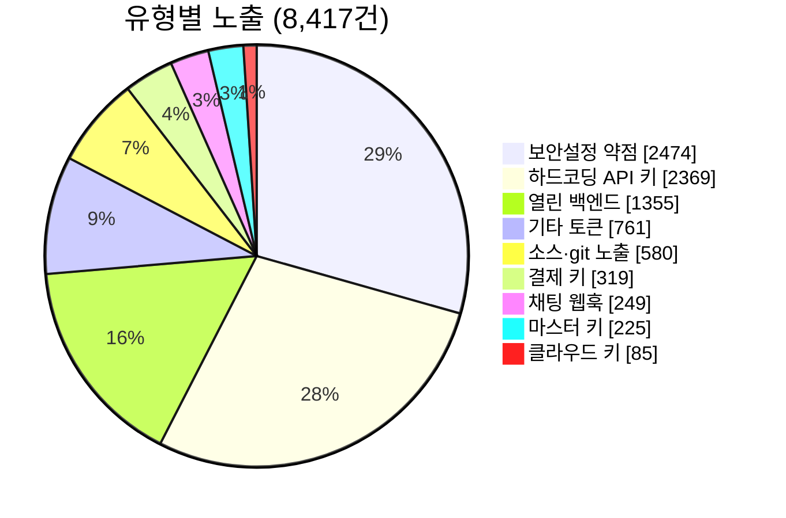
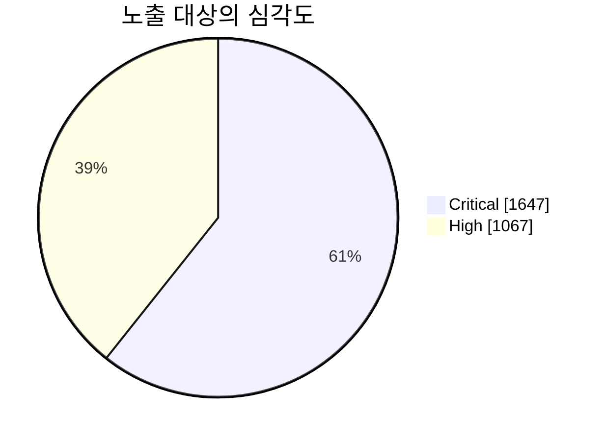

<!-- Repo: security-secret-exposure-research · README.md (한글판) · GitHub에서 Mermaid 차트 렌더됨 -->

# 앱 시크릿 노출 — 측정 연구

공개 배포되는 **앱과 웹사이트 안에 그대로 담긴 자격증명** — 대규모로 측정하고, 책임 있게 신고하고, 아무것도 악용하지 않았습니다.

**이주호 (Joe Lee)** · 고등학생 독립 연구자, 대한민국 · [leejooho.me](https://leejooho.me) · security@leejooho.me

**스캔 91,287건 · 노출 8,417건 · 사용한 키 0 · 측정 2026년 9월**

> **한 줄 요약** — 공개 앱·웹 약 9만 1천 건을 오프라인으로 스캔해 8,417건의 노출을 찾았습니다. 대부분은 고난도 취약점이 아니라 배포 전에 빼지 못한 단순 실수입니다. 찾은 키는 단 하나도 쓰지 않았고, 심각한 건은 책임 있게 신고했습니다.

---

## 왜 시작했나

개발하다 키 하나를 공개된 곳에 실수로 올린 적이 있고, 친구들도 같은 실수를 했습니다. 그래서 측정할 수 있는 질문을 던졌습니다 — **이런 실수는 과연 얼마나 흔한가?** 이 저장소는 그 답입니다. 일화가 아니라 측정입니다.

→ 전체 이야기: **[why-i-started.md](./why-i-started.md)**

---

## 무엇을 찾았나

**공개 앱·웹 91,287건에서 8,417건의 노출.** 유형별:

```text
앱·서버 보안설정 약점            ████████████████████  2,474
하드코딩된 API 키                ███████████████████   2,369
인증 없이 열린 클라우드 백엔드    ███████████           1,355
기타 서비스 토큰                 ██████                  761
소스코드·소스맵(.git) 노출        █████                   580
결제 키                          ███                     319
채팅 웹훅(Slack/Discord)          ██                      249
마스터 키(서비스계정·개인키)      ██                      225
클라우드 액세스 키(AWS)           █                        85
```



보안설정 약점과 하드코딩 키만 약 58%입니다 — 대부분은 고난도 취약점이 아니라 **배포 전에 빼지 못한 단순 실수**입니다.

### 심각도



- **Critical (1,647)** — 악용 시 **백엔드 접근·금전 작업·신원 위조로 곧장 이어질 수 있는** 노출. 예: 클라우드 서비스계정 키, 결제 키, 개인키, 전권 토큰, 인증 없이 열린 데이터베이스.
- **High (1,067)** — **서비스 오용·할당량 도용·설정/정보 노출**로 이어질 수 있는 노출. 예: 오용 가능한 API 키, 서버 보안설정 약점, 소스·설정 파일 노출.

### 악용 시 피해가 큰 유형

- **클라우드 서비스계정 키 141건** — 백엔드 데이터·스토리지에 서버급으로 접근할 수 있는 열쇠.
- **결제 키 319건** — 결제·환불 등 금전 작업 권한.
- **개인키(PEM/RSA) 162건** — 서명·암호화 신뢰의 뿌리.
- **클라우드 액세스 키 85건** — 계정 리소스 전반에 영향.

---

## 어떻게 봤나

공개 패키지를 내려받아 **내 컴퓨터에서 오프라인으로만** 분석합니다. 자격증명은 형식·구조만 로컬에서 확인해 진짜와 오탐을 가립니다. **제3자 서버에 접속하지 않고, 데이터를 읽지 않고, 어떤 공격도 하지 않습니다.** 스캐너 구현은 악용 방지를 위해 공개하지 않습니다.

**제가 지키는 선**
- 찾은 키를 쓰지 않습니다.
- 남의 데이터를 읽지 않습니다.
- 서버를 공격하지 않습니다.
- 회사·앱·키의 이름을 공개하지 않습니다.

---

## 책임공개

심각한 사례는 개발사와 국가 CERT 등 **적절한 경로로 조용히 신고**합니다. 공개적으로 회사·앱·키를 밝히지 않으며, 발견한 키는 쓰지 않습니다. 가장 심각한 27건은 국가 CERT(KrCERT/KISA)에 접수했습니다.

---

## 한계 (정직하게)

- **대표 표본 아님** — 기회 수집이라 "전체 앱의 X%"로 읽으면 안 됩니다.
- **노출 ≠ 악용 가능** — 바이너리의 키가 곧 살아있는 키는 아닙니다. 확인하려면 써야 하는데, 쓰지 않습니다.
- **일부는 원래 클라이언트용 키**(지도 키 등) — 구분했으나 완벽하지 않습니다.
- **스캐너는 놓칩니다** — 모든 수치는 하한선입니다.
- **스냅샷** — 2026년 9월 측정 기준입니다.

---

## 데이터 · 연락

- **익명 집계 데이터셋**(유형×건수 + 데이터시트) — `dataset.csv`, CC BY 4.0
- 회사·앱·키 식별정보는 책임공개 원칙에 따라 공개하지 않습니다. 검증 자료는 사적으로 제공합니다.

**연락** — security@leejooho.me · [leejooho.me](https://leejooho.me)
