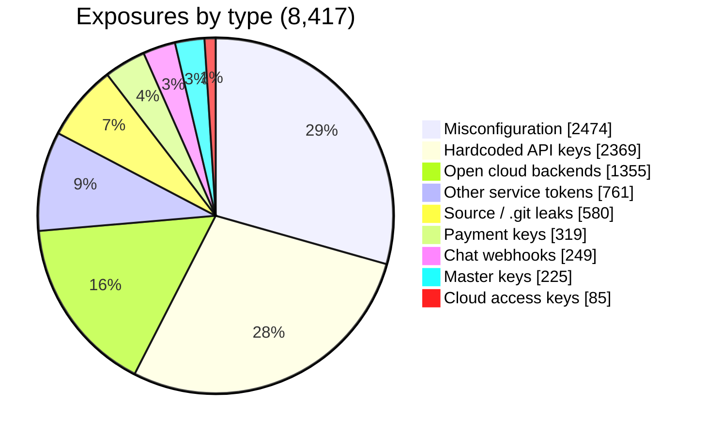
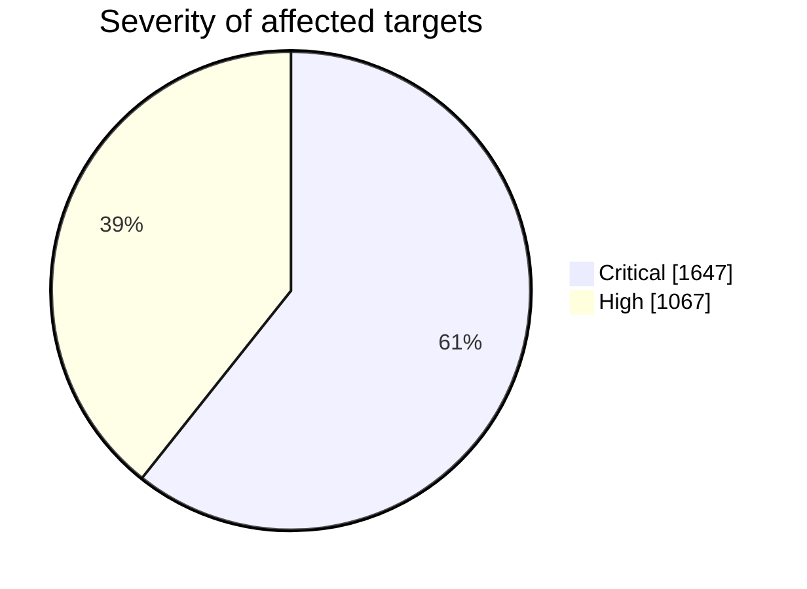

<!-- Repo: security-secret-exposure-research · README.md · drop-in for GitHub (Mermaid charts render on github.com) -->

# App Secret Exposure — A Measurement Study

Credentials accidentally shipped **inside publicly distributed apps and websites** — measured at scale, reported responsibly, nothing exploited.

**Joe Lee (이주호)** · independent high‑school researcher, Korea · [leejooho.me](https://leejooho.me) · security@leejooho.me

**91,287 scanned · 8,417 exposures · 0 keys used · measured Sep 2026**

> **TL;DR** — I scanned ~91,000 public apps and sites offline and found 8,417 exposed credentials/config issues. Most are not exotic vulnerabilities but simple mistakes left in before release. I never used a single key, and I reported the serious cases responsibly.

---

## Why I started

While coding I once pushed a key to a public place by accident, and friends had made the same mistake. So I asked a question I could actually measure: **how common is this, really?** This repo is the answer — a measurement, not an anecdote.

→ The longer story: **[why-i-started.md](./why-i-started.md)**

---

## What I found

**8,417 exposures across 91,287 public apps & sites.** By type:

```text
App / server misconfiguration    ████████████████████  2,474
Hardcoded API keys               ███████████████████   2,369
Open cloud backends (no login)   ███████████           1,355
Other service tokens             ██████                  761
Source / sourcemap (.git) leaks  █████                   580
Payment keys                     ███                     319
Chat webhooks (Slack/Discord)    ██                      249
Master keys (SA / private keys)  ██                      225
Cloud access keys (AWS)          █                        85
```



Misconfigurations and hardcoded keys alone are ~58% — most of this is **mistakes left in before release**, not exotic vulnerabilities.

### Severity



- **Critical (1,647)** — exposures that can lead **straight to backend access, money movement, or identity forgery**: cloud service‑account keys, payment keys, private keys, full‑access tokens, databases open without login.
- **High (1,067)** — exposures that can lead to **service abuse, quota theft, or config/info disclosure**: misusable API keys, server misconfigurations, source/config file leaks.

### High‑impact types

- **Cloud service‑account keys — 141** — server‑level access to backend data and storage.
- **Payment keys — 319** — refund/charge authority.
- **Private keys (PEM/RSA) — 162** — the root of signing & encryption trust.
- **Cloud access keys — 85** — account‑wide resource impact.

---

## How I looked

I download the public package and analyze it **offline, on my own machine**. Credentials are checked locally for format/structure only, to tell real ones from false matches. **I never contact a third‑party server, never read anyone's data, and never run any attack.** The scanner implementation is not published, to avoid misuse.

**The line I hold**
- I never use a key I find.
- I never read anyone's data.
- I never attack a server.
- I never name the company, app, or key in public.

---

## Responsible disclosure

Serious cases are reported quietly through the right channels (the developer, and the national CERT where applicable). I don't name companies, apps, or keys publicly, and I don't use the keys I find. The most serious 27 cases were filed with **KrCERT/KISA**.

---

## Honest limits

- **Not a representative sample** — opportunistic collection; don't read these as "X% of all apps."
- **Exposure ≠ exploitability** — a key in a binary isn't proven live; confirming would mean using it, which I don't.
- **Some keys are meant to be client‑side** (e.g. map keys) — distinguished, imperfectly.
- **Scanners miss things** — every number is a lower bound.
- **Snapshot** — measured Sep 2026.

---

## Data & contact

- **Anonymized dataset** (type × count, with a datasheet) — `dataset.csv`, CC BY 4.0
- Company/app/key identifiers are withheld per responsible‑disclosure norms; verification available privately.

**Contact** — security@leejooho.me · [leejooho.me](https://leejooho.me)
